# The Revenger - 4x4 Rubik’s Cube Solving Robot

This project presents the development of an efficient computational solver for the 4x4 Rubik's Cube and its implementation within a robotic system that achieves a world record solving time.

The approach uses a 2D array of integer facelet identifiers, which is the most suitable data structure for the 4x4 Rubik's Cube. This data structure is used in an 8 phase solving algorithm inspired by Tsai's method, and presented as the first C++ implementation of its kind. The approach is original yet closely based on Tsai's framework, offering a unique variation that prioritises practicality and performance. The 8 phase method achieves short solutions with an average move count of 67.79 moves in near real time. Additionally, novel research was conducted into optimising a computational solver to the characteristics and constraints of a specific robotic system, an area that has not been previously explored in existing literature. Unlike existing 4x4 solvers, this project is the only one accompanied by any explanation of the underlying theory and implementation, making it the first truly transparent and practical resource for 4x4 computational solving. The robot was designed and constructed from the ground up using fully custom parts and original architecture, independent of existing designs. The integration of the computational solver and robotic system achieved a solve time of 47.93 seconds, a 39.08% improvement over the current official world record. 

These results demonstrate that the robot, named 'The Revenger', has achieved an unofficial new world record time for solving the 4x4 Rubik's Cube. In due course the evidence will be submitted to Guinness World Records for review of official recognition.

A video demonstration of the robot is available on [YouTube](https://youtu.be/tE4DD7Fw6SM).

# Development Progress

## Mechanical Design
The robot started as hand drawn concept sketches exploring how to grip and turn the cube, then went through several 3D printed prototypes before arriving at the finished design.

<p align="center">
  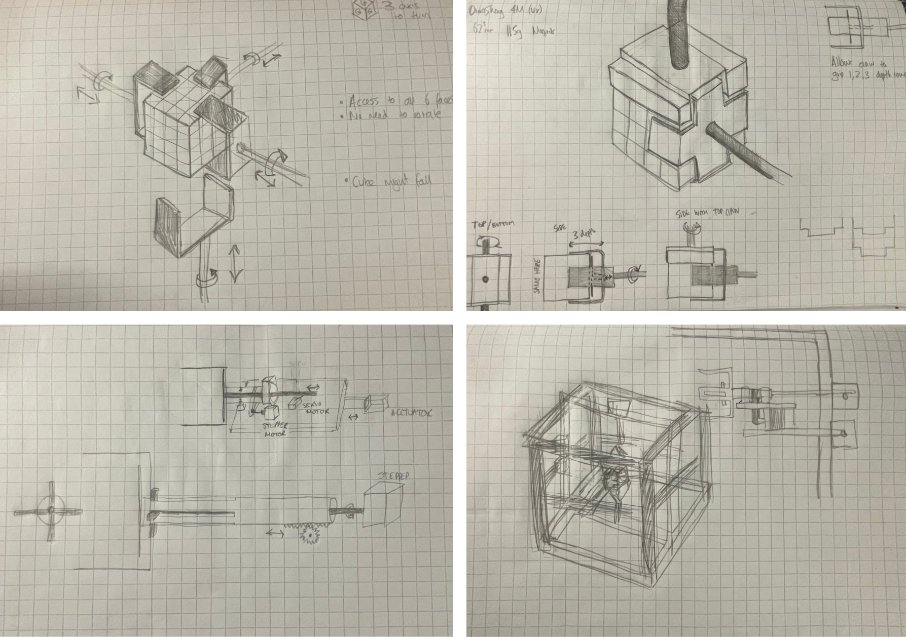
  <br><em>Initial hand drawn concept sketches</em>
</p>

<table>
  <tr>
    <td align="center" width="33%">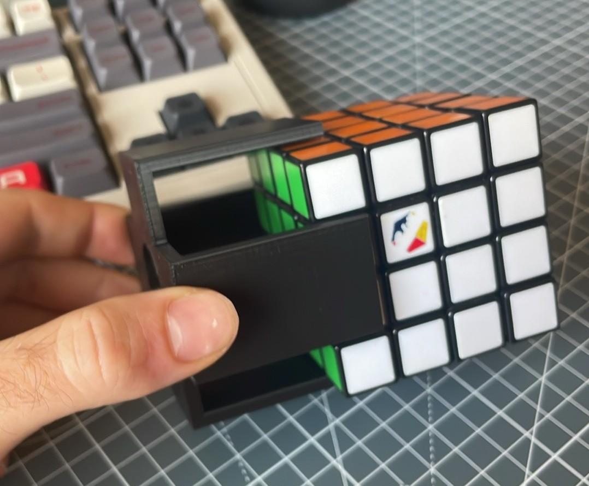<br><em>1. First 3D printed gripper test</em></td>
    <td align="center" width="33%">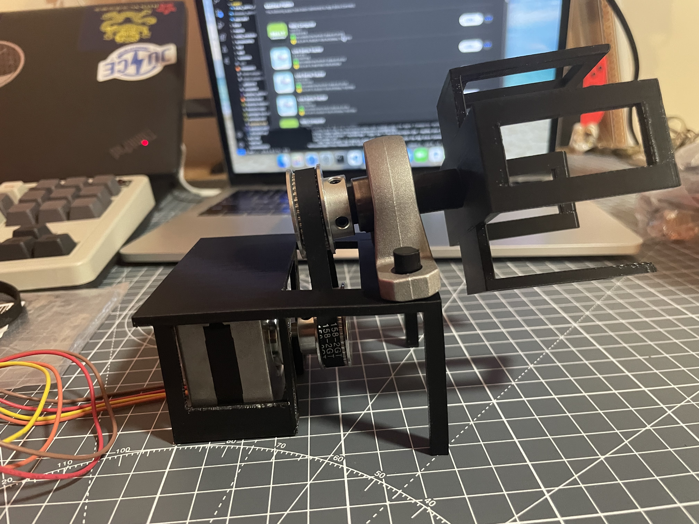<br><em>2. Belt driven rotating gripper</em></td>
    <td align="center" width="33%">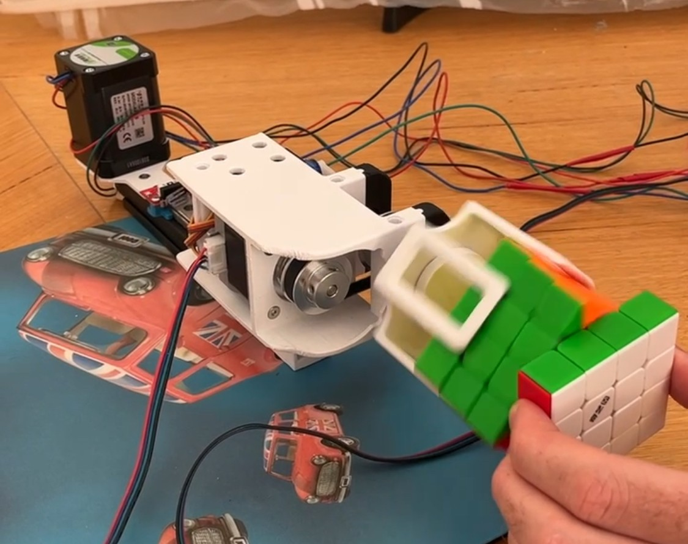<br><em>3. Stepper powered gripper turning a cube</em></td>
  </tr>
  <tr>
    <td align="center" width="33%">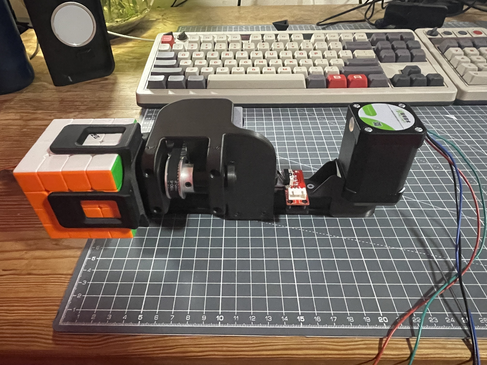<br><em>4. Refined gripper with linear actuation</em></td>
    <td align="center" width="33%">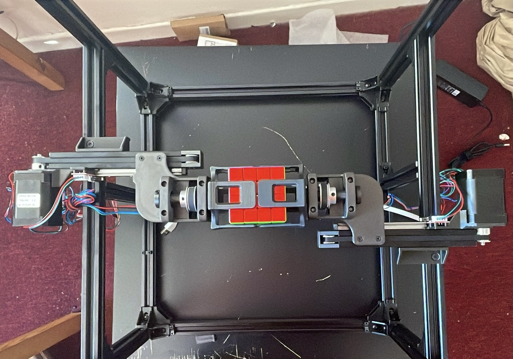<br><em>5. Opposing grippers mounted in the extrusion frame</em></td>
    <td align="center" width="33%">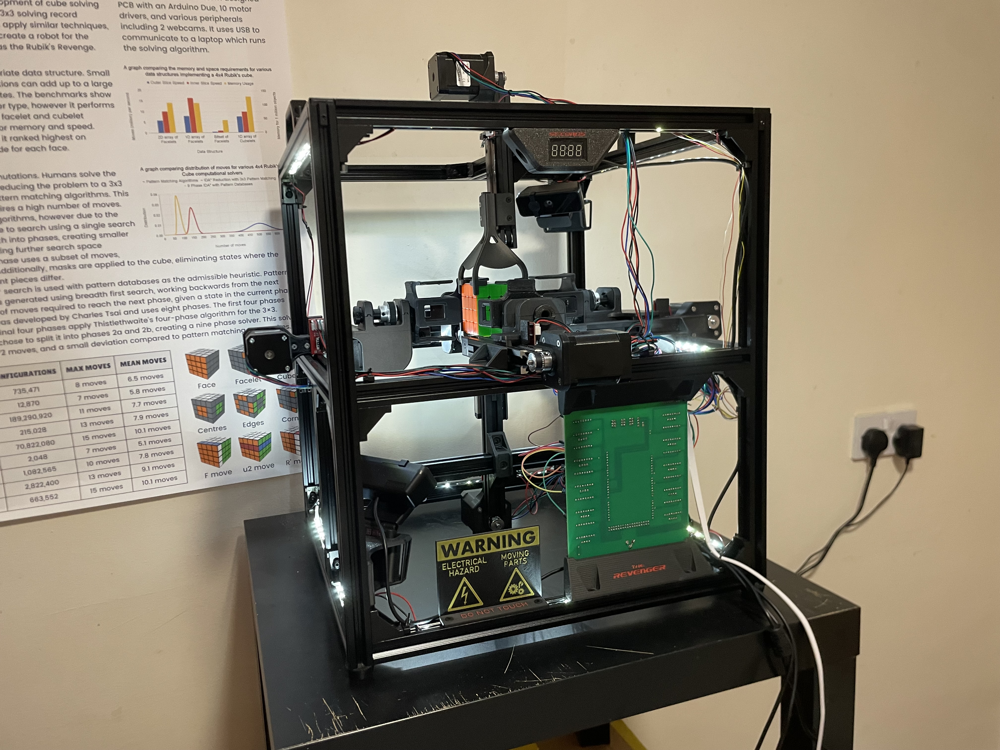<br><em>6. The finished robot</em></td>
  </tr>
</table>

## Electrical System
The electronics began as a single stepper driver on a breadboard and grew into a custom PCB that hosts the Arduino Due, all ten stepper drivers, limit switches, display and buzzer.

<table>
  <tr>
    <td align="center" width="33%">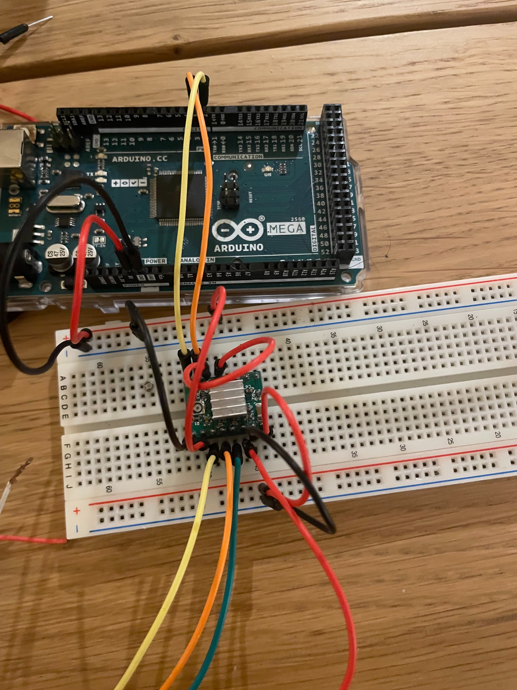<br><em>1. Breadboard prototype with a single stepper driver</em></td>
    <td align="center" width="33%">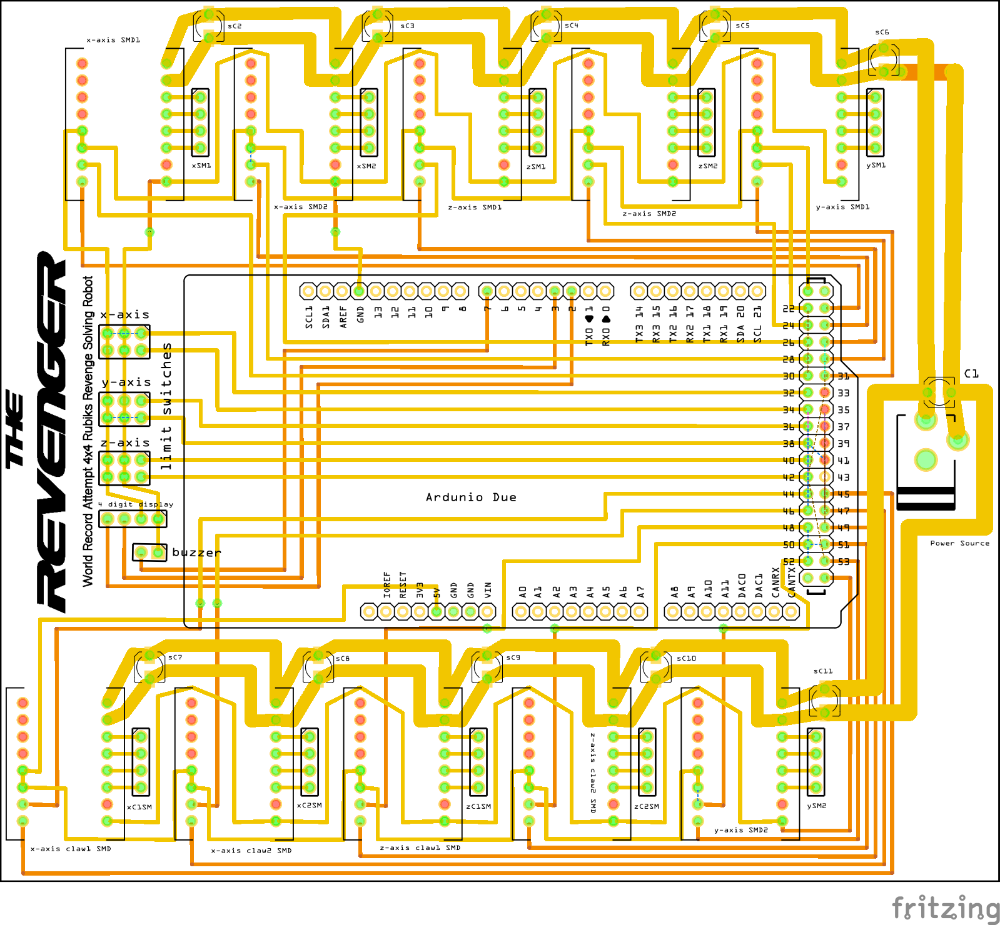<br><em>2. Custom PCB design</em></td>
    <td align="center" width="33%">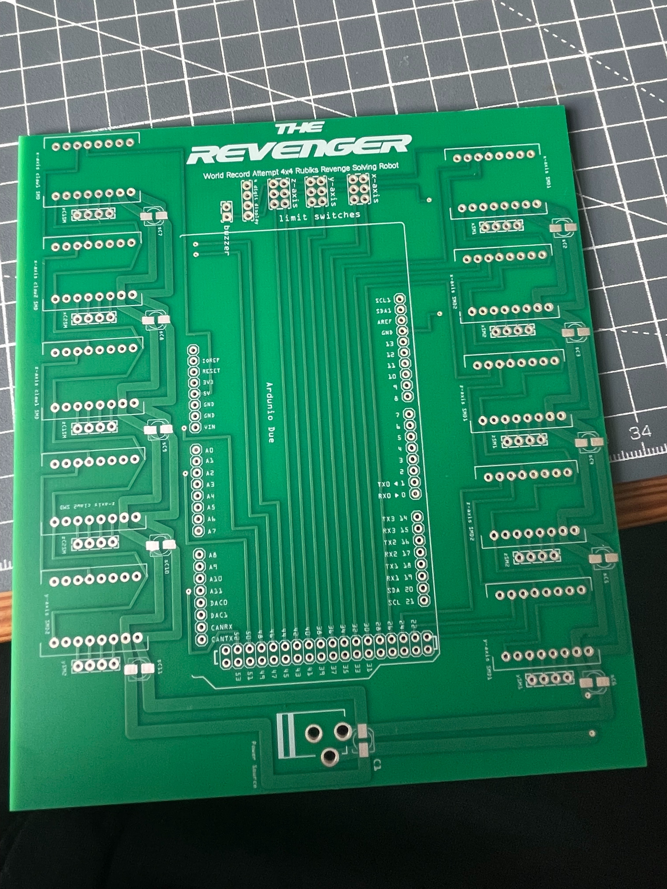<br><em>3. Manufactured PCB</em></td>
  </tr>
  <tr>
    <td align="center" width="33%">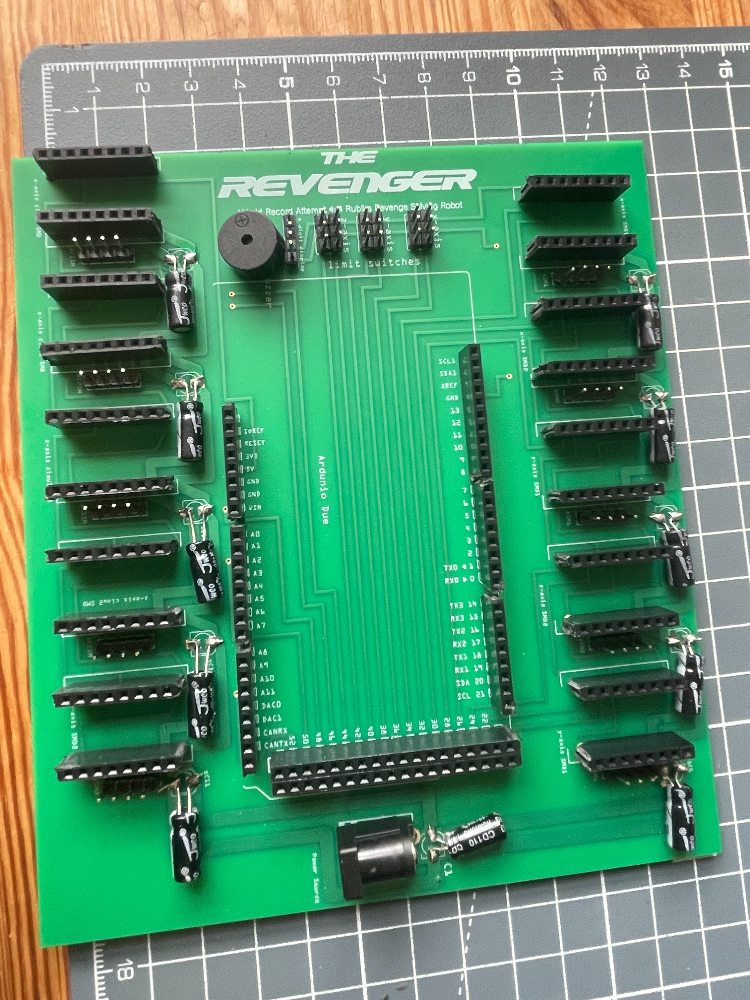<br><em>4. PCB populated with headers and components</em></td>
    <td align="center" width="33%">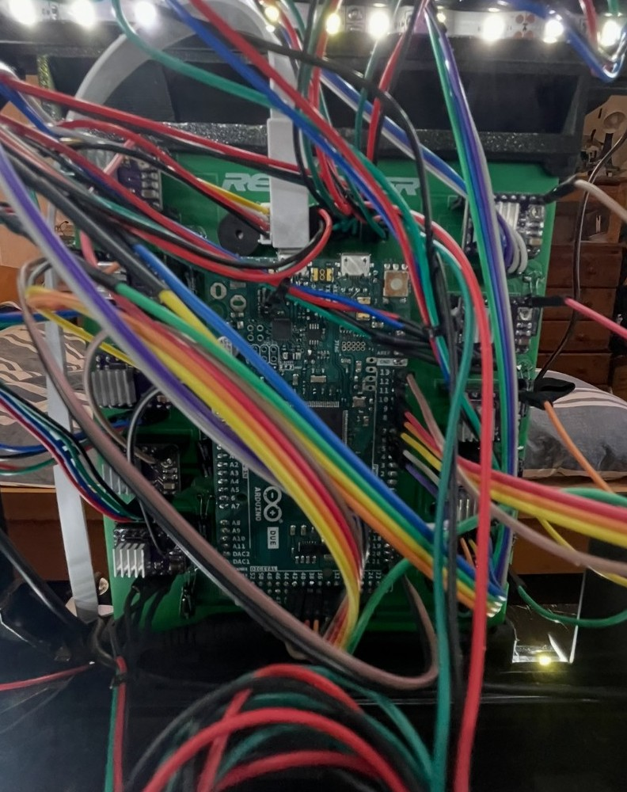<br><em>5. Fully wired into the finished robot</em></td>
    <td></td>
  </tr>
</table>

# Publicity
- [BBC News](https://www.bbc.co.uk/news/articles/cvgnlvevj5ro)
- [ITV News](https://www.itv.com/watch/news/computer-science-student-builds-rubiks-cube-solving-robot/rpgy89p)
- [Press Release](https://www.bristol.ac.uk/news/2025/may/rubiks-cube-world-record.html)
- [Interesting Engineering](https://interestingengineering.com/innovation/students-robot-beats-4x4-rubiks-cube-world-record)
- [Bristol 247](https://www.bristol247.com/news-and-features/news/world-record-solving-rubiks-cube-using-robot-smashed-bristol-student/)
- [The Tab](https://thetab.com/2025/05/14/bristol-uni-student-breaks-world-record-with-dissertation-project)
- [Epigram](https://epigram.org.uk/university-of-bristol-student-breaks-world-record/)
- [Newsroomin](https://newsroomin.eu/en/bristol-students-robot-rubiks-cube-world-record/)
- [Linkedin](https://www.linkedin.com/posts/university-of-bristol_now-thats-how-to-nail-your-dissertation-ugcPost-7328061358967590914-5NA0?utm_source=share&utm_medium=member_desktop&rcm=ACoAAB49w38BtYxwj7Bp4-EsDsFL2CtKWY5PnKE)

# Project Structure
```
code/ 
  solver/
  scanner/ 
  master/
  microcontroller/ 
parts/
  pcb/
media/
```

# Instructions
To run the 8 phase solver, first download the latest binary assets from [here](https://github.com/mattpidden/the-revenger/releases) and place them in the `code/solver` directory. Then type `make` to generate the compiled solver. Run `./solver -s` to solve a cube. It expects a 96 char input of the inital cube state.

To run the master program use `python main.py` inside the `code/master` directory. 

To run the computer vision scanning use `python manual_scan.py` inside the `code/scanner` directory. It is important that you calibrate your cameras first using `python calibrate_cameras.py`.

Upload the microcontroller code to an Arduino using the offical software.

# Parts List
Along with the parts provided that you will need to 3D print, there are also a selection of parts to source from elsewhere.
- Custom PCB (see files) (1 pcs)
- 360x20x20mm extrusion (14 pcs)
- 480x20x20mm extrusion (4 pcs)
- 150x20x20mm extrusion (5 pcs)
- 200x20x20mm extrusion (1 pcs)
- MGN12 100mm linear rail (5 pcs)
- MGN12 150mm linear rail (1 pcs)
- MGN12H sliding carriage blocks (6 pcs)
- Corner connections for 20x20mm extrusion
- 2GTx160x6mm timing belt (6 pcs)
- 2GTx6mm spool timing belt
- 2GT pulley, 20 teeth, 5mm bore (6 pcs)
- 2GT idler, 5mm bore (6 pcs)
- 2GT pulley, 40 teeth, 12mm bore, 28mm dia (4 pcs)
- 2GT pulley, 40 teeth, 5mm bore, 30mm dia (4 pcs)
- NEMA 17 0.65 Nm stepper motor (6 pcs)
- NEMA 17 0.45 Nm stepper motor (4 pcs)
- Endstop mechanical limit switch (6 pcs)
- 2 Lenovo Essential FHD webameras
- Arduino Due (1 pcs)
- DRV8825 stepper motor driver (10 pcs)
- TM1637 4 digit 7 segment display (1 pcs)
- DC buzzer (1 pcs)
- LED ring light (2 pcs)
- Capacitors
- Male and female header pins
